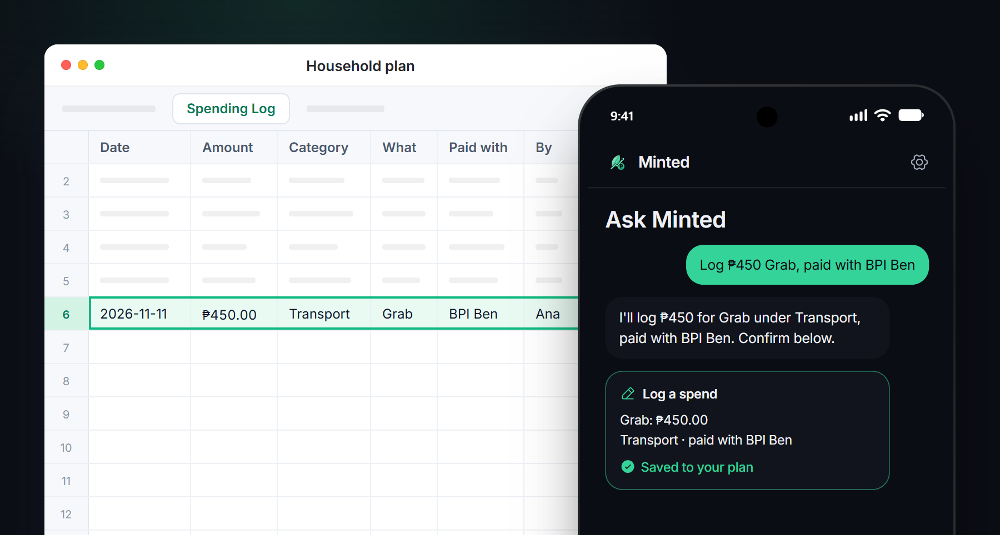
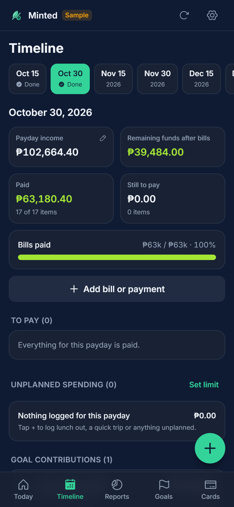
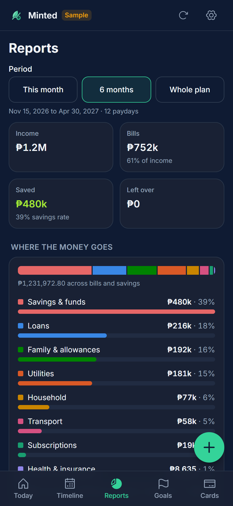
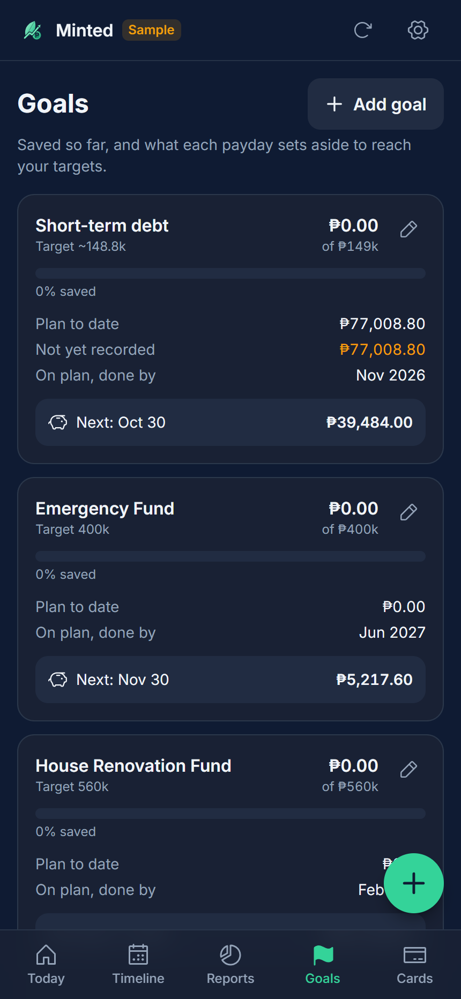
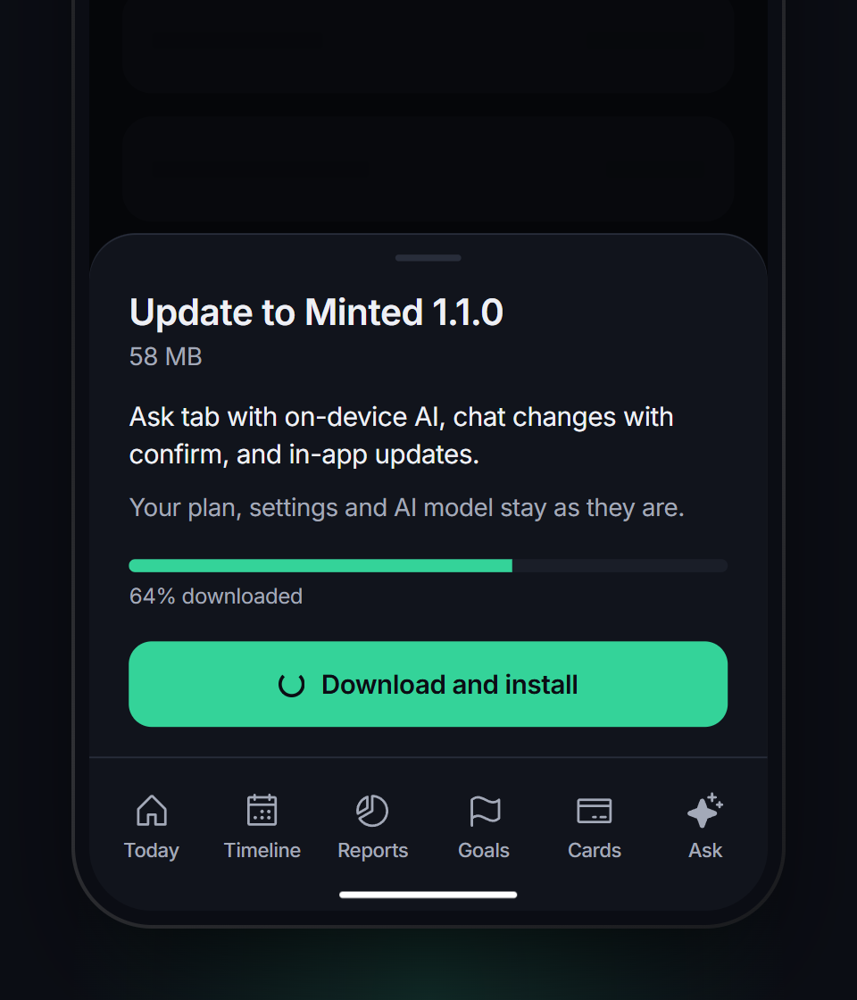

# Minted for Android

Minted is a budget app for a household that plans its money in a Google Sheet. It shows what's due on each payday (the 15th and the 30th), lets you tick off bills as you pay them, and writes everything back to the sheet, so both phones see the same numbers.

This repository holds the Android releases. The app checks it for updates by itself.

  

## Install

1. On your Android phone, open the [latest release](https://github.com/iamfercatapang/minted-releases/releases/latest) and download the `.apk` file under **Assets**.
2. Open the downloaded file. Android asks you to allow installs from your browser or file manager the first time: turn on **Allow from this source**, then go back and tap **Install**.
3. If Play Protect warns that the app is unrecognized, tap **More details → Install anyway**. Minted isn't on the Play Store, so Google hasn't scanned it.
4. Open Minted and tap **Continue with Google**. While Minted's Google sign-in is in testing, only accounts the developer has added can sign in.

Android 7.0 or later. The on-device assistant needs a phone with about 6 GB of RAM or more.

## What's inside

  
  
  

- **Paydays.** Each payday's income, what's paid, what's still due, and what's left after bills. Tap a bill to mark it paid at the amount you actually paid.
- **Spending.** The **+** button logs unplanned spending, with an optional limit per payday.
- **Cards.** Statement and due days, the best card to use today, and reminders before each card is due.
- **Goals and funds.** What's saved, the target, and when the plan gets there.
- **Reminders.** Phone notifications before a bill is due, unless that month is already paid.
- **Ask.** A money coach that knows your plan: ask whether you can afford something, where the money goes, or how to grow your savings. It can log a spend, mark a bill paid, record a card payment, take money out of a fund or add extra income, and **nothing is saved until you tap Confirm**. It runs on your phone (Gemma, a one-time 2.4 GB download, works offline and keeps your data on the phone) or with Google Gemini. Answers are general guidance, not licensed financial advice.

## Updates

Minted checks this page when it opens, and from **Settings → App → Check for updates**. When a new version is out, a banner appears; tap **Update**, then **Download and install**, and Android's Install screen opens. The first time, Android asks you to allow installs from Minted.

Your plan lives in your Google Sheet, and your settings and the on-device model stay on the phone, so updating never loses anything.

If you installed Minted 1.0.0, install 1.1.0 once by hand from the [releases page](https://github.com/iamfercatapang/minted-releases/releases); from then on the app updates itself.

 

## Privacy

- Your money data stays in your own Google Sheet. Minted has no server.
- The on-device assistant never sends anything off the phone.
- If you choose Google Gemini instead, Minted shows what it sends first: a summary of your plan with each question, without your name, email or the sheet itself.

## Releases

| Version | What changed |
| --- | --- |
| [1.1.0](https://github.com/iamfercatapang/minted-releases/releases/tag/v1.1.0) | The Ask tab with an on-device assistant, changes from chat that wait for Confirm, and in-app updates |
